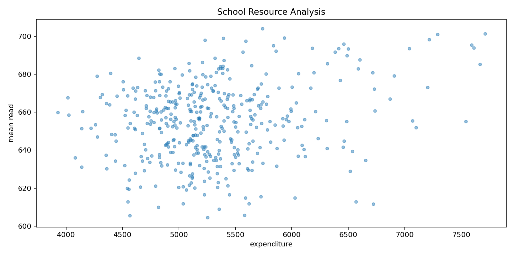

# School Resource Analysis — executed results

## Decision question
How are expenditure per student and reading scores associated?

## Evidence
Among 420 complete observations, Pearson r = 0.218 and Spearman rho = 0.132.

Raw rows: 420. Rows used: 420. Excluded for missing/nonfinite required values or invalid denominator: 0.

## Method
Complete-pair scatter plot of expenditure and read, with Pearson and Spearman correlations. No regression adjustment or causal claim.

## Interpretation and limitations
District-level observational data; income and learner composition may confound results. No causal inference, significance claim or production deployment is implied. Missing values are not imputed; identical rows are retained. Small or repeated samples limit uncertainty interpretation.

## Recommended next decision
Compare adjusted associations and resource allocation context.

## Reproducibility
Source and exact downloaded-byte SHA256 are recorded in run_manifest.json. SQL results are in answer.csv and analysis.sqlite. Review quality_audit.csv before interpretation.
